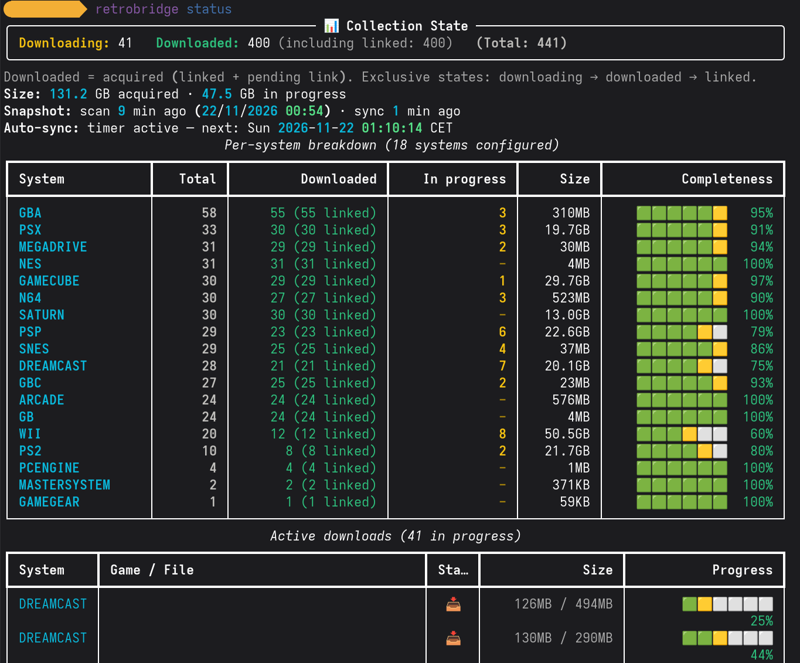
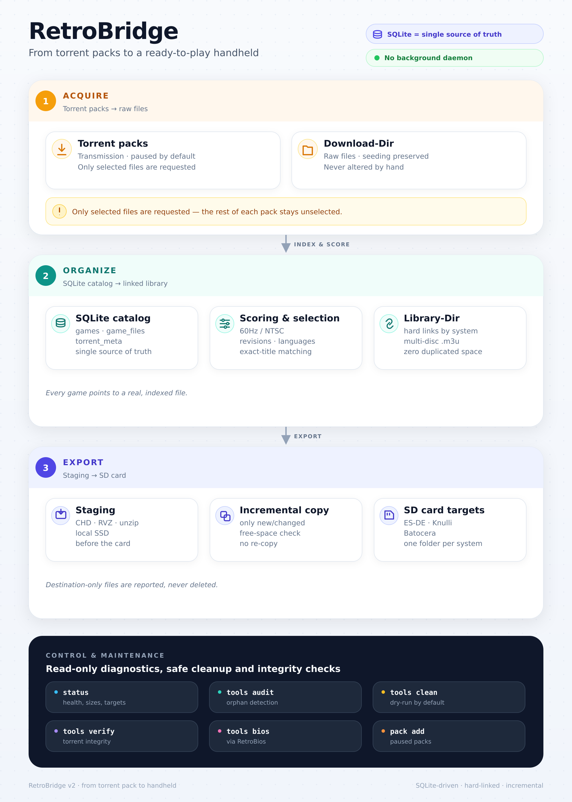

# RetroBridge 🕹️

[](https://github.com/ikkan-me/retrobridge/actions/workflows/ci.yml)
[](https://www.python.org/)
[](LICENSE)

RetroBridge automates the gap between raw game downloads and ready-to-play handhelds. It seamlessly links Transmission torrent packs to an organized local library via hard links, and syncs curated setups directly to your ES-DE, Knulli, or sd-cards.

<p align="center">
  
</p>

<p align="center"><sub>Example output of <code>retrobridge status</code> — collection state, per-system completeness and active downloads.</sub></p>

> ⚠️ **Legal notice** — RetroBridge is a local organization and automation tool. It does not provide, host, or distribute any game, game file, BIOS, or other copyrighted material. Torrent packs, game files, and BIOS used with it come exclusively from third-party sources chosen by the user; the user must hold the necessary rights (owned games, BIOS licenses, local law). The author accepts no liability for how the tool is used. RetroBridge is not affiliated with Nintendo, Sony, Sega, Microsoft, or any publisher or rights holder.

---

## 🧭 How it works

<p align="center">
  
</p>

<p align="center"><sub><a href="docs/retrobridge-flow.svg">Open the vector version</a></sub></p>

1. **Acquire** — add a paused torrent pack, then select only the games you want. Transmission fetches the chosen files into the raw **Download-Dir**, preserving seeding.
2. **Organize** — RetroBridge indexes the packs in SQLite, scores candidates (60Hz/NTSC, revisions, languages), and creates **hard links** in the **Library-Dir**. Multi-disc games get `.m3u` playlists automatically.
3. **Export** — only new or changed games are converted in local staging (`.chd`, `.rvz`, `.zip` extraction) and copied to the SD card targets (**ES-DE**, **Knulli**, **Batocera**).

The SQLite catalog is the single source of truth. `status`, `tools audit`, `tools clean`, `tools verify`, and `tools bios` stay available at every stage.

---

## 🎯 Architecture principles

- **Single source of truth**: a SQLite database (`~/.local/share/retrobridge/retrobridge.db`) drives all states (games, selected game file, torrent cache, exports). A game always references a real file from an indexed pack: `tools audit` and `sync` reject orphan references.
- **No background daemon**: no resident service. A TTL system on metadata triggers the required refreshes on demand, protected by a non-blocking file lock (`fcntl.flock`).
- **Three-directory model**:
  1. **Download-Dir**: raw directory where Transmission downloads and seeds (never manually altered).
  2. **Library-Dir**: clean local tree organized by system, using **hard links** to the Download-Dir (no duplicated disk space, same filesystem).
  3. **Targets**: portable SD cards (Anbernic, Miyoo, Steam Deck, etc.) identified by a UUID file (`.retrobridge-target`).
- **SD card preservation**: all heavy decompression and conversion (`chdman`, `dolphin-tool`) runs on your local SSD in a temporary staging directory (`/tmp/retrobridge/staging`) before the final file is copied to the SD card.
- **60Hz / NTSC scoring first**: absolute priority to 60Hz versions (USA / World / Japan), automatic selection of the most recent versions (`v2.00 > v1.01`, `Rev 2 > Rev 1`), and automatic fallback to PAL 50Hz when the game was only released in Europe.

---

## 🚀 Quick start

```bash
git clone https://github.com/ikkan-me/retrobridge.git
cd retrobridge
python3 -m venv .venv
source .venv/bin/activate
pip install -e .
```

### Configuration (`~/.config/retrobridge/config.toml`)

The file is generated automatically and can be edited freely:

```toml
[paths]
download_dir = "/mnt/hdd-data/RetroGaming/Download"
library_dir  = "/mnt/hdd-data/RetroGaming/Library"
data_dir     = "~/.local/share/retrobridge"

[transmission]
host = "127.0.0.1"
port = 9091
path = "/transmission/rpc"
user = ""
password_env = "RETROBRIDGE_RPC_PASSWORD"
timeout = 30.0  # seconds (increase if Transmission is slow or saturated)

[ttl]
scan_ttl   = 3600  # seconds before rescanning torrents
status_ttl = 600   # seconds before `status` triggers an automatic sync

[scoring]
region_preference = "NTSC"   # NTSC (60Hz first) or PAL
pal_language      = "french" # Preferred language when falling back to PAL

[targets.rg35xx]
profile    = "esde"
mount_path = "/run/media/your-user/SDCARD"
uuid       = "rg35xx-sd-card-uuid"
```

---

## 🎮 User commands

### 1. `retrobridge status`
Displays the global collection status, share ratio, and storage health in one screen:
```bash
retrobridge status
retrobridge status --json
retrobridge status --no-refresh   # do not trigger an automatic sync
```

If the last sync is **older than 10 minutes**, `status` automatically runs a `sync` before rendering (independently of the systemd timer). The delay is configurable via `[ttl] status_ttl` (600 s by default).

### 2. `retrobridge find <search> -s <system>`
Searches the torrent cache, checks cache freshness, and lets you add the game:
```bash
retrobridge find "Gran Turismo 4" -s ps2            # search + add prompt (q = cancel)
retrobridge find "Gran Turismo 4" -s ps2 --no-add   # search only
retrobridge find "Gran Turismo 4" -s ps2 --yes      # best exact candidate
retrobridge find "Ico" -s ps2 --update
```
- Interactive add after selection: answer `q` (or anything that is not a number) to cancel.
- `--no-add`: search only.
- `--yes`: best candidate, only when the title is an exact match.
- `--update`: replaces the game file of an already present game.
- `--dry-run`, `--limit`, `--full-path`, `--json`, `--no-refresh`.
- In `--json`, `find` is **read-only** unless `--yes` is used (no prompt).
- Adding starts the download in Transmission immediately. If the RPC fails, a message asks you to run `retrobridge sync`.
- Multi-disc games automatically select all available discs (same game/region).

`search` and `add` remain available as hidden aliases for scripts.

### 3. `retrobridge sync [--dry-run]`
Full local reconciliation:
- Checks download state in Transmission.
- Creates **hard links** in `Library-Dir` for completed game files.
- Automatically groups multi-disc games `(Disc 1)`, `(Disc 2)` and generates `.m3u` playlists.
- Executes pending local deletions.
```bash
retrobridge sync --dry-run
retrobridge sync
```

### 4. `retrobridge export <target> [--tier 1|2|3] [--system X] [--raw] [--dry-run]`
Incremental export to an SD card:
- Pre-checks free space on the card.
- Differential detection: only converts and copies new or modified games.
- Automatic conversion based on profile (`.chd` for PS1/PS2/Saturn, `.rvz` for GameCube/Wii, `.zip` extraction for NES/SNES/GBA).
```bash
# Partial export of 2D classics (Tier 1)
retrobridge export rg35xx --tier 1

# Full collection export
retrobridge export rg35xx

# Dry run without writing
retrobridge export rg35xx --dry-run
```

### 5. Locking & deletion
- **`retrobridge pin <title>` / `unpin <title>`**: locks the selected game file to exclude it from automatic replacements.
- **`retrobridge remove <title>`**: safe asynchronous deletion (unselects in Transmission, removes the hard link in Library-Dir, deletes the raw file in Download-Dir if not shared, and schedules cleanup on SD cards).

### 6. `retrobridge pack add <file.torrent>`
Adds a game pack paused in Transmission **and unselects all its files**:
```bash
retrobridge pack add ~/torrents/my-pack.torrent
```
No bytes are downloaded until a game is explicitly added with `add`. `--keep-all` keeps the full selection if you want the whole pack.

### 7. `retrobridge setup [--check] [--step N]`
Replayable configuration wizard:

| Step | Content |
| :---: | :--- |
| 1 | Download-Dir / Library-Dir paths, destination profile, and SD mount point |
| 2 | Transmission connection (host, port) |
| 3 | Scoring preferences (NTSC / PAL) |
| 4 | Optional automation (systemd user timer) |

`retrobridge setup --check` shows the full diagnostic (Python, Transmission, `chdman`, `dolphin-tool`, disk space, shared partition).

---

## 🛠️ Utility commands (`retrobridge tools`)

**Packs and Transmission**
- **`retrobridge tools scan`**: forces immediate caching of Transmission torrent files.
- **`retrobridge tools apply [--dry-run]`**: aligns Transmission priorities with the actual selection: only files for added games remain requested, the rest of the packs is unselected (also run by `sync`).
- **`retrobridge tools audit`**: checks that no game is orphaned (file missing from indexed packs, file gone from disk, duplicates). `sync` also reports any orphan automatically.
- **`retrobridge tools pause <id>` / `resume <id>`**: direct torrent control (pause, resume).
- **`retrobridge tools verify [id]`**: verifies a torrent; without an ID, verifies all torrents reported as errored or corrupt.
- **`retrobridge tools relocate <id> <new-path>`**: moves a torrent's data and realigns its location in Transmission.
- **`retrobridge tools clean`**: lists orphan files in Download-Dir (dry-run by default); `--apply` deletes them.

**Export**
- **`retrobridge tools prepare-export <target> [--system X] [--tier N] [--dry-run]`**: converts files to the export format in the staging directory without writing to the card.
- **`retrobridge tools profiles`**: lists available frontend profiles (`esde`, `knulli`).

**BIOS and database**
- **`retrobridge tools bios`**: suggests installing BIOS via **RetroBios** (external tool) without duplicating its catalog.
- **`retrobridge tools db init`**: initializes the SQLite v2 schema.
- **`retrobridge tools db migrate [--dry-run]`**: aligns data with canonical system codes (merges legacy aliases `GC`, `GENESIS`, `PS1`, `SMS`, `GG`, `TG-16`).
- **`retrobridge tools db backup [--dest <path>]`**: creates a timestamped copy of the database.
- **`retrobridge tools db import-legacy <legacy_manager.db>`**: imports an old v1 database (games without a real file are ignored).

---

## 📊 Export tiers

Easily adapt your collection to the size of your micro-SD card:

| Tier | Name | Included systems |
| :---: | :--- | :--- |
| **1** | **2D classics** | NES, SNES, Mega Drive, Master System, Game Gear, PC Engine, GB, GBC, GBA, Arcade |
| **2** | **First 3D** | Tier 1 + PS1, Saturn, Nintendo 64 |
| **3** | **PS2 & beyond** | Tier 2 + Dreamcast, PS2, GameCube, Wii, PSP, Nintendo DS |

---

## ⏱️ Optional periodic synchronization (systemd user)

No daemon is required: `sync` remains runnable manually. To automate it every 10 minutes:

```bash
mkdir -p ~/.config/systemd/user
cp systemd/retrobridge-sync.* ~/.config/systemd/user/
systemctl --user daemon-reload
systemctl --user enable --now retrobridge-sync.timer
systemctl --user list-timers retrobridge-sync.timer
```

The RPC password can be supplied in `~/.config/retrobridge/rpc.env`:

```bash
echo 'RETROBRIDGE_RPC_PASSWORD=change-me' > ~/.config/retrobridge/rpc.env
chmod 600 ~/.config/retrobridge/rpc.env
```

---

## 🧪 Tests & quality

Unit and characterization tests run via `pytest`:
```bash
pytest -v tests
```
All suites are covered (v1 characterization, lock, profiles, hard-link sync, asynchronous deletion, multi-disc m3u, incremental export, NTSC 60Hz scoring).

---

## 👏 Acknowledgements & credits

- **[RetroBios](https://github.com/Abdess/retrobios)** by [Abdess](https://github.com/Abdess): many thanks for the exceptional work on centralizing, checksum-verifying (SHA256), and distributing BIOS files for retro gaming emulation platforms.

---

## 📄 License

Distributed under the **MIT** license — see [LICENSE](LICENSE). The software is provided "as is", without warranty of any kind. This license does not cover games, BIOS, or torrent packs, which remain subject to their own rights and licenses.
